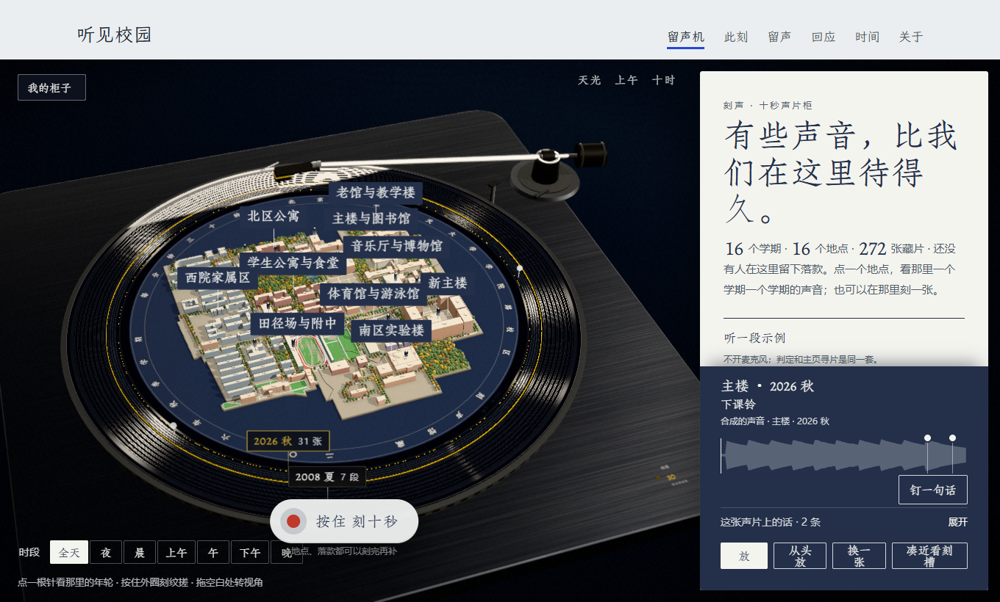
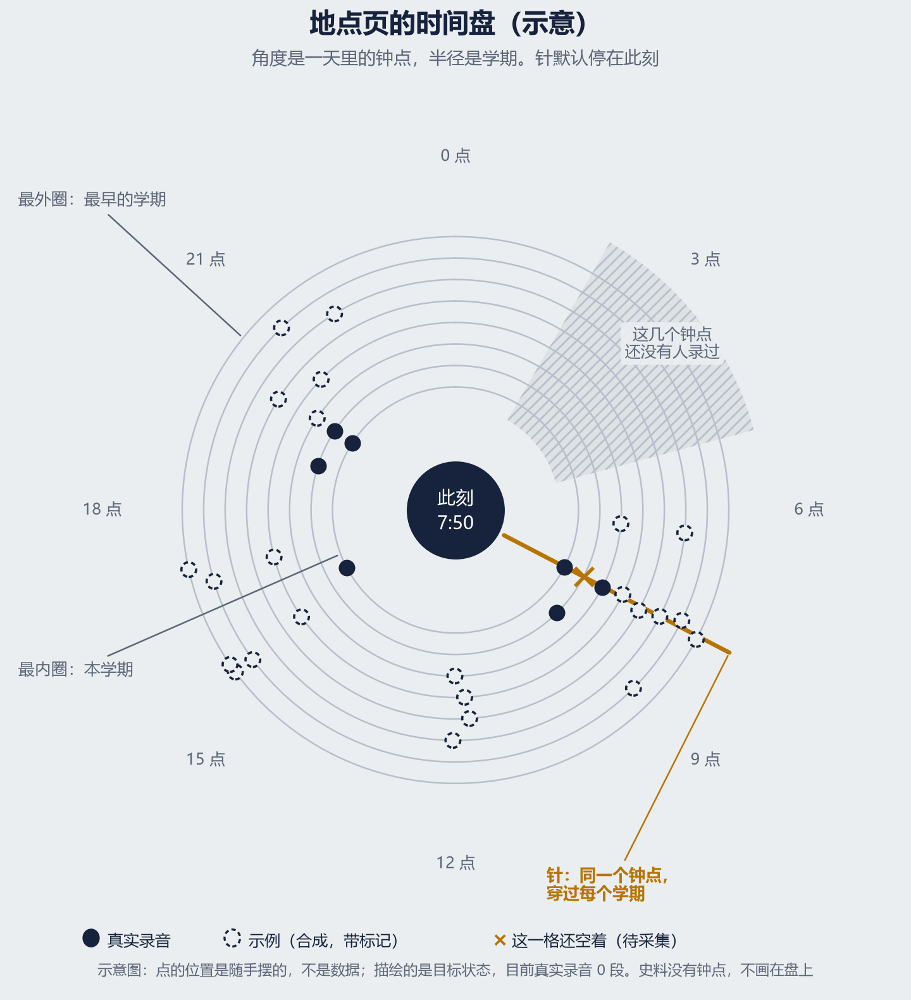
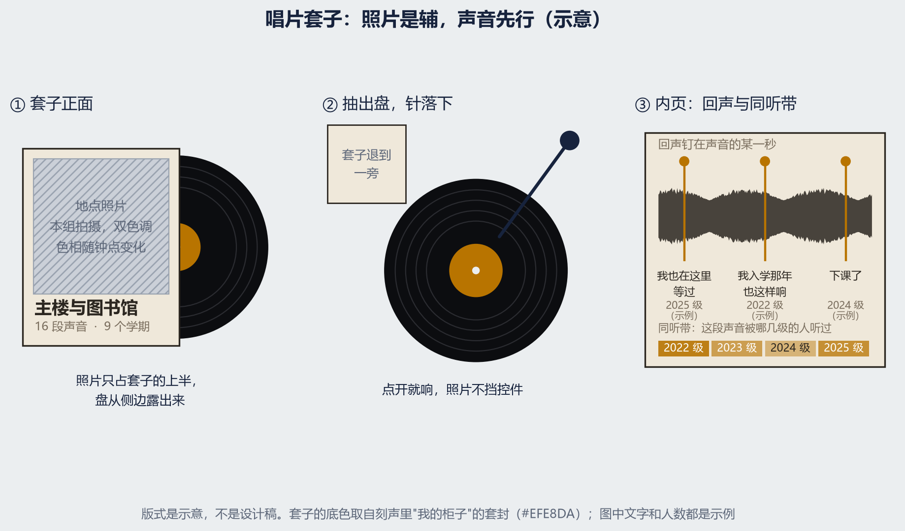
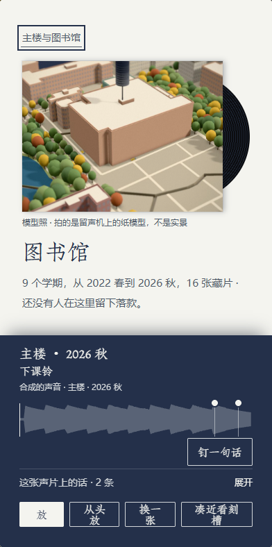
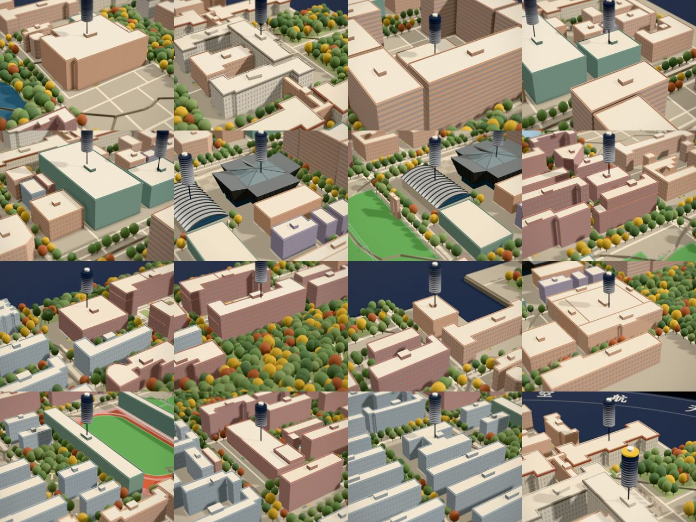
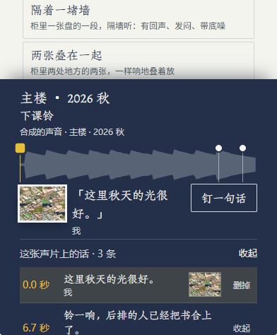

# 全盛形态与未竟之业

> 听见校园 · 留声机。2026-11-24 整理，ClawsGO Science Agent。V2 愿望清单也记在这里（`AGENTS.md` §6）。

2026-11-24 整理。ClawsGO Science Agent。

这份文档分两半。前一半写已经做到的东西，每一项后面有命令和输出，能复查。后一半写还没做的想法，每一条带着最小版和退路。没做过的东西不写成已经做到。

## 一、现在已经有的

*首页：整屏留声机。右下角的播放器里，波形上竖着的两根钉是钉在那一秒的话。图是无头浏览器截的，软件渲染。*

| 项 | 状态 | 证据 |
|---|---|---|
| 首页是整屏留声机 | 已做 | `npm run e2e` 58 项通过，其中首页 3 项：嵌入的是刻声分区图、导航高亮、撑满屏幕 |
| 回声带：钉在某一秒的话 | 已做 | `npm run e2e:kesheng` 28 项通过，回声相关：载入、链接被拦、号码被拦、`<b>` 原样显示、话在云上、另一个人看得到 |
| 盘面回声针：同一句话立在刻纹上那一秒的位置，跟盘转 | 已做 | 针数与回声带的钉数相等（冒烟里有断言）；放大截图里能看到针头落在刻纹上 |
| 唱片套子：地点卡的正面是一张照片，右边露出半张盘 | 已做，照片是模型照 | 16 个地点各一张，角标写"模型照"；实拍还没有 |
| 示例回声 | 已做，全部示例 | 34 条，覆盖 32 张声片，只写年级，页面上每一条标"示例"；钉的秒数对准合成声里最响的那一刻 |
| 仿宋子集补字 | 已做 | 补 63 个字，875 个字符，只增不减（脚本核对丢失 0） |
| 后端 | 没有真后端 | 页面按云优先写好了，契约在 `contract.js`；开发用模拟器随 `npm run dev` 自带，能验证"A 留的话，B 看得到"，不能验证 CloudBase |
| 照片进社区 | 已做（对模拟器） | 回声可以配照片：设备上去掉定位信息，勾选同意，先审后显；针走到那一秒照片显影；地点页有印样；有社区照片时套子换面。`check:cloud` 44 项、`e2e:kesheng` 28 项通过 |
| 真实录音 | 0 段 | 231 张概念盘和 8 段示例都是合成声，41 段史料不算真人 |
| 手机真机、读屏器 | 没测 | 只在无头 Chrome 的软件渲染和 Node 26 上跑过 |

代码在 PR #23 与 PR #27（people/naruto7/mvp）。决策记录是 0005 和 0006，素材来源是 docs/design/素材来源.md。

## 二、全盛形态：一座放了很多年的留声机

一句话：同一个钟点，不同年份的人听着同一个声音。

刻声已经把"一个地点一个学期一圈"做成了年轮，外圈的学期带也是同一件事。我们加的这一层是人：一圈圈的刻纹上，有人在某一秒停下来，写了一句话。三个时间尺度叠在一张盘上。

- 一天：钟点。盘面的天光跟着时段走，窗灯夜里亮起来。
- 一学年：学期带。最外一带是最早的学期，挨着校园的是最近的。
- 一代人：回声。2021 级的人在第 7.5 秒写的那句话，2025 级的人也读得到。

首页主句现在用的是「有些声音，比我们在这里待得久。」组长还没表态。备选还有四句，在决策 0003 里。选它的理由：它不依赖数据量，史料本身就是证据；它也不预设来的人是哪一级。

*想法示意：地点页里的时间盘。角度是一天里的钟点，半径是学期，针是此刻的钟点，穿过每个学期。图里点的位置是随手摆的，不是数据。*

## 三、照片：是辅，不框死用途

组长的话：上一次项目里套子这个想法落实得不充分，有遗憾；这次要把视觉加进来，定位不能错，是辅。

组长后来补了一句：照片不要框死用途和权限，唱片套只是一个举例和一个小细节。所以照片现在有三处用法，定位仍是辅：声音是主线。

- 套子：地点卡的正面。有审核通过的社区照片就换成最新一张，角标写"来自社区"；没有就用模型照，角标写"模型照"。
- 钉在某一秒：回声可以配一张照片。针走到那一秒，照片像相纸一样显影。
- 印样：地点页一条"这里的照片"，一格一张，最新的在前，点开是大图。

规矩只有四条：每张照片的来源如实标；没有照片的地方不放假图；上传前勾选"照片里没有能认出身份的人，或我已经问过"；先审后显，通过之前只有上传的人自己看得到。

*套子的三个状态（示意）：正面，抽出盘，内页。现在做到第一个，鼠标移上去盘往外抽一点。内页还没做。*

 

*左：地点卡上的套子，图书馆。右：十六个地点的模型照。模型照拍的是留声机上的纸模型，机位固定，个别地点取景要人看一眼。*

*回声配照片：浮出的那句话左边是照片，下面列表里每条带缩略图。图里的照片是模型照拍成的测试图，不是用户照片。*

## 四、数据放哪：云优先

组长纠正过一次：我曾把"后端还没接"写成了"照片只存本机"，这是两回事。整个项目都是上云的，本机只是发件箱和缓存。

| 放哪 | 内容 | 理由 |
|---|---|---|
| 云 | 声片与档案、回声、照片（缩略和大图）、落款快照、同听、举报与审核状态、同意记录、计数 | 别人要看到的、要长期在的、要统计的。计数由服务端算，页面只显示 |
| 本机 | 发件箱（还没发出的话和照片）、"对我隐藏"、录到一半的声音 | 只有自己要用，或者丢了能重来。断网时话显示"待发出"，连上自动发 |
| 不留 | 照片里的 EXIF（含拍摄地点） | 设备上重新编码时去掉，服务端对每张再剥一遍 |

现在没有真后端。`scripts/dev-cloud.mjs` 是开发用云模拟器，实现同一份接口契约，`npm run dev` 与 `preview` 自带。它能验证"A 留的话，B 看得到"，不能验证 CloudBase。决策记录是 0006。

## 五、未竟之业

每一条写最小版和退路。排序按"先让社区成立，再让它被看见"。

| 想法 | 最小版 | 退路 |
|---|---|---|
| 答辩现场扫码，"我也听过"，大屏数字实时跳 | 一张二维码，扫开地点页，点一下记一次；大屏读后端的计数 | 录屏加静态快照。依赖后端，后端没通就不能说"社区" |
| 时间胶囊：开工周留下的声音先封住，汇报当天开封 | 本机版先做界面：封存、到期、开封。到期过滤最后必须在服务端做 | 不做封存，汇报日直接放开工周留下的那批。越晚定，能封进去的越少 |
| 地点有自己的网址，现场扫码直达 | 路由 /place/XY01 打开留声机并飞到那根针 | 只保留卡片。现场张贴要先问学校能不能贴 |
| 时间盘：同一个钟点穿过每个学期 | 地点页里一张二维盘，数据读现有的年轮 | 用刻声已有的年轮图 |
| 回信：回应另一个人的回声，或写给过去的自己 | 回声带上多一个"回一句"，链成 parentId | 只留回声，不留回信 |
| 同场多轨：同地同时有几个人录 | 自动归成"一场"，逐条切机位听 | 不做。叠放会变成盲合奏，等于噪声 |
| 实拍套子与内页 | 每人拍一个地点，内页写"这里的从前"（史料）和年轮 | 继续用模型照，角标不变 |
| 照片的更多用法 | 对拍：拍照时叠上这个地点上一张照片的半透明轮廓，对齐同一个角度，拍完两张成对。分享卡：照片裁成套子，旁边是这段声音自己的盘面，可以存图。锁屏封面：播放时系统控件显示这个地点的套子 | 只做分享卡，它最便宜，只要一张图 |
| 手机上的二维圆盘 | 同一份数据画成 2D，桌面和大屏保留三维 | 手机用 ?q=lite 的省电档 |
| 两份声音数据合并 | 外壳的 8 段并进刻声的概念盘，页面只剩一套"留一句话" | 外壳退成"此刻"和"留声"两个入口，数据都读刻声那份 |

最先砍的是同场多轨和实时同刻（几个人同一秒一起听）。它们依赖采集量，数据少的时候最不成立。

要保住的只有一件：钉在刻槽里的话。波形、盘面、列表三处指同一个瞬间，这是整个作品里最容易被记住的东西。其余的都安静地围着它。

## 六、没验证的

- 手机真机上三维加回声针的帧率。刻声自己有画质自动降级，没实测。
- 回声钉在"最响的一秒"，是拿合成声的包络算的。真实录音没有这个保证，到时候要人工看一遍。
- 嵌入留声机的 iframe 里，读屏器的体验。
- 两份声音数据没合并，用户会遇到两种"留一句话"。
- 后端 CloudBase 全部来自文档检索，没注册过，没调用过。
- 照片谁来审：先审后显需要有人审，现在没有人定。答辩前没人审，照片会一直是"审核中"。
- iPhone 默认的 HEIC 格式在非 Safari 浏览器里可能读不出，页面会提示换成 JPEG，这条没有真机测过。
- 每 15 秒取一次回声会不会耗云的额度，没算过。
- 纸模型照的取景。16 张里体育馆、游泳馆这类大体量建筑，机位固定会不会切掉主体，要人看。
