# 声景校园 · 北航 —— 听见学院路

一座可以转着看的 3D 卡纸校园，也是一张**能「看」声音的声景地图**：16 处地点、4 个园子，每一处都有一份声景档案——手绘声纹、声音构成、一段故事，以及一圈按声音类别着色的粒子波纹。

它来自「刻声 · 十秒声片柜」的三维校园，正在长成一个「听见校园」的作品：**先不导入音频**，用数据、动画和程序化声景把声音先「画」出来。

**打开就是完整的校园。** 页面里内置了一张预渲染的总览图，网络一到就能看到整座校园；大约 1 秒内，它会被可转动的三维模型替换掉（同一机位，看不出接缝）。

模型上钉着 16 个小圆点，按声景类别着色。点一下，相机飞到它所在的区块，同时从区块中心荡开一圈**该类别颜色**的粒子波纹——波纹会绕着楼走、撞上墙会反射、越扩越淡，两秒后消失。右侧同时翻开这一处的声景档案：声纹、声音构成、故事，以及它在不同天光下的样子。

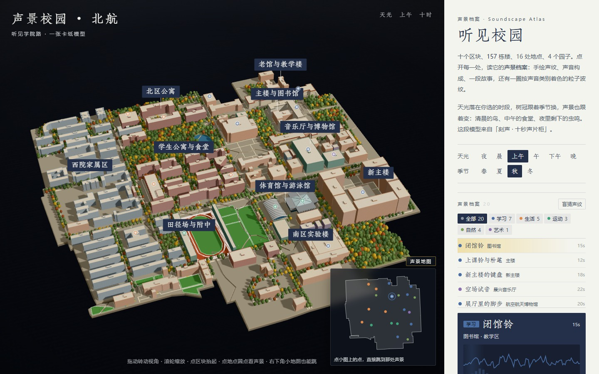

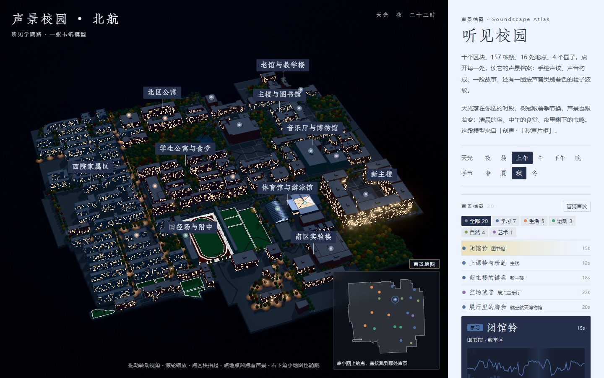

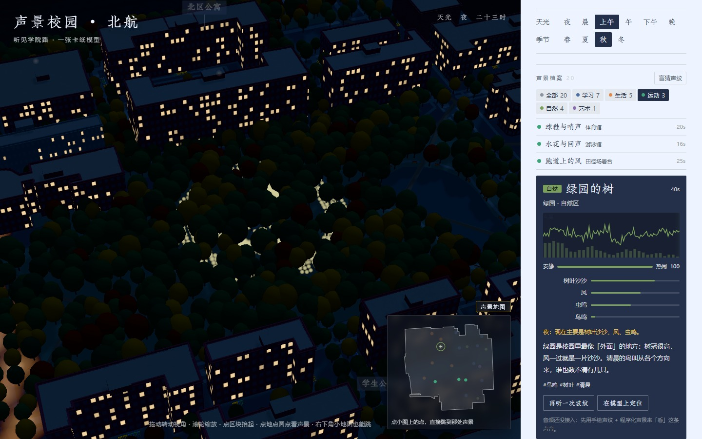

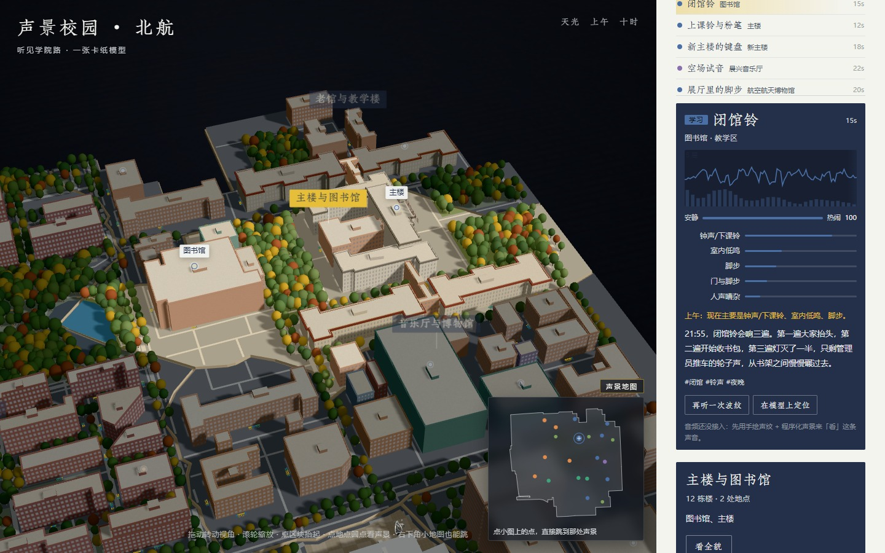


## 这是什么

「声景校园 · 北航」是一个只关于校园的声景作品：一座能转着看的 3D 卡纸校园（取自「刻声 · 十秒声片柜」，MIT），加上 20 条声景档案（16 处地点 + 4 个园子），以及**不加载任何音频文件**的程序化 WebAudio 声景。点一个地点，模型会飞过去、从该地点荡开粒子波纹、并让那一处的"声音"响起来；每个地点还有自己的详情页（声纹、声音构成、故事、全景、笔记、收藏、路线、明信片、长图等）。

**快速开始**：双击 `打开网站.cmd`（或在本目录执行 `node serve.mjs`），浏览器打开 <http://127.0.0.1:8890/>。不能直接双击 `index.html`（ES 模块 + fetch 需要经 HTTP）。

## 版本迭代总览

> 每一版都备份在 `D:\大学\web work\backup_*`，根目录 `index.html` 是版本索引。

| 版本 | 加入的功能 |
|---|---|
| v1 | 基线：3D 卡纸校园、157 栋楼、16 处地点、粒子波纹、天光/四季（backup_0） |
| v2 | 声景档案：20 条声景、五类、声纹动画、声音构成、故事、小地图、盲猜、类别着色粒子 |
| v3 | 程序化声景：WebAudio 实时合成 20 套配器、随地点/时段变化、声像、默认静音、音量与电平 |
| v4 | 声景路线：加入路线、自动播放、`#walk=` 分享链接 |
| v5 | 声景热力图：小地图「点位 / 热力」切换 |
| v6 | 一天里的声景：档案里的时段条，点一下切天光 |
| v7 | 声景明信片：导出 1200×675 PNG |
| v8 | 路线预设：清晨 / 午间 / 夜行 / 安静 + 随机漫游 |
| v9 | 声景图鉴：20 条收集册与进度（本机保存） |
| v10 | 声景搜索：标题 / 地点 / 标签 / 类别，`/` 聚焦 |
| v11 | 声景对比：两条并排看声纹、热闹度与共有声音层 |
| v12 | 沉浸模式：`Z` 隐藏界面只剩校园与声音 |
| v13 | 键盘快捷键 + 帮助表（`1–6`、`s`、`g/b/c`、`p`、`?`） |
| v14 | 声景长图：20 条排成一张 1400×2200 PNG |
| v15 | 今日声景：按日期推荐一条，可换一条 |
| v16 | 骰子：随机跳一处声景 |
| v17 | 实时天光：按真实钟点自动选天光 |
| v18 | 我的收藏：星标收藏条（本机保存） |
| v19 | 声景笔记：每条写一句笔记（本机保存） |
| v20 | 复制文案：一键复制标题/地点/故事/标签 |
| v21 | 三种配色：纸 / 夜 / 蓝图 |
| v22 | 声音统计：条数、类别分布、平均热闹度、收藏/路由数 |
| v23 | 关于：作品定位、数据来源、技术栈 |
| v24 | 分享视图：`#view=` 链接（天光/季节/声景） |
| v25 | 演示模式：自动巡演天光、季节与声景 |
| v26 | 声音日记：最近听过的 8 条 |
| v27 | 摇一天：随机天光 + 季节 + 三站路线 |
| v28 | 降低动效：关过渡/声纹动画，尊重系统设置 |
| v29 | 列表排序：默认 / 热闹度 / 名称 / 类别 |
| v30 | 导出：收藏、笔记、图鉴、日记导出 JSON |
| v31 | 五类声音说明卡 |
| v32 | 波纹修正：从地点圆点起波、撞楼一半反射一半吸收、常驻「天光」时间条 |
| v33 | 地点全景：右侧小框自动右→左→右 8 秒循环（占位 SVG，可换真实照片） |
| v34 | 「更多」：本机上传 / 查看照片与声音（IndexedDB），不改变地点默认声景与全景 |
| v35 | 黑胶唱片托底：大黑胶 60 秒/圈、纹路厚度、模型底沿埋入唱片 + 柔和接触阴影 |
| v36 | 唱针：默认抬起，有声音播放时落针、暂停抬起 |
| v37 | 木制大针脚：圆角木板（长 0.8R、宽 0.15R）；固定点外移到 1.62R，播放时与圆心连线成 15° |
| v38 | 去掉右侧副屏：主屏铺满；左下角四组控件（天光/季节/声音/唱片）；点地点出对话气泡，点气泡进入整屏详情页（原副屏全部功能） |
| v38.1–38.3 | 换地点/切区块时旧气泡立刻消失；详情页铺满整屏（全景通栏、列表左、详情右） |
| v38.4 | 气泡放大概览 + 全景小图；详情页可整页滚动、全景完整显示、进页回顶部 |
| v38.5–38.7 | 下滑时全景连续缩小右移成右上角预览（滚动驱动），上滑反向恢复；预览可点击回顶部 |
| v38.8 | 「我拍的照片」每张加点赞 / 评论图标（功能待做） |
| v38.9 | 默认状态：上午 · 夏 · 声音开（首次交互解锁自动播放）· 唱片转 |

## 声景档案（v2 创新）

这一版把「点击一个地方播放音频」的设想，先做成**看得见的声音**。不加载任何音频文件，而是给 16 处地点 + 4 个园子各写一份声景档案：

- **类别**：学习 / 生活 / 运动 / 自然 / 艺术。类别颜色贯穿 3D 圆点、粒子波纹、小地图与筛选条；
- **声纹**：由「声音构成」决定的波形 + 频谱动画（不是录音，是数据画出来的，每一条都不同）；
- **声音构成**：钟声、室内低鸣、脚步、人声嘈杂、风、鸟、虫、水花……每一层一根权重条；
- **故事**：50–150 字的一段场景——闭馆铃、食堂刷卡声、宿舍楼下的猫、跑道上的风、校医院走廊的秒针；
- **时刻**：同一处声景在 夜 / 晨 / 上午 / 午 / 下午 / 晚 的构成会变：清晨鸟多、午间食堂吵、夜里只剩虫鸣与室内低鸣；
- **热闹度**：由各层权重算出的 0–100 指标。

三个入口：

1. 右侧**声景档案列表 + 五个类别筛选**：筛选时 3D 圆点、小地图、列表一起变暗/变亮；
2. 三维画面右下角的**声景小地图**：校园轮廓 + 20 个类别色点，悬停出名字，点击直接跳到那处声景；
3. 模型上的 16 个地点圆点：按类别着色，点一下从所在区块中心起该类别颜色的粒子波纹。

还有一个「**盲猜声纹**」小游戏：随机亮出一条声纹，从三个地点里猜是哪儿——把音频版的「盲听猜地点」先用视觉做了一遍。

## 程序化声景（v3 创新）

上一轮只有「看得见的声音」，这一轮让它**真的响**——但仍然**不加载任何音频文件**：

- 每一条声景的「声音构成」直接驱动一个 WebAudio 合成器：噪声 + 滤波器 + 低频调制做环境底噪（风、树叶、车流、室内低鸣、人声嘈杂、机器），短包络音做事件（钟声、鸟叫、虫鸣、哨声、球、脚步、餐盘、刷卡、开关门、猫叫、钢琴）；
- 20 条声景 = 20 套不同的配方，权重来自 `soundscape.js`，所以换一条声景就换一套配器；
- 切天光时段时，各层权重按 `SLOT_GAIN` 重新推一遍：清晨鸟多、中午食堂吵、夜里虫鸣和低鸣留下来；
- 左右声道按「声源相对镜头朝向」自动偏移，走近声源会稍微响一点（`StereoPanner` + 距离因子）；
- **默认静音**：右侧「声音」点成「开」之后才创建 AudioContext（浏览器要求用户手势），旁边有音量滑杆和实时电平条；
- 声音会跟着当前选中的声景走：点列表、点小地图、点 3D 圆点、自动换时段，都是同一套。

> 声音全部由代码实时合成，没有一条录音、没有一个音频文件。合成器的参数是示意性的（好听、像那回事），不是声学测量。

## 声景路线 / 声音散步（v4 创新）

把声景点串成一条可以播放的散步路线：

- 在声景档案里点「**加入路线**」，最多 8 站；路线条显示成一串编号标签；
- 点「**播放**」：自动按顺序飞过去、切换声景、切换程序化声音，每站停 5.6 秒，走完自动结束；
- 播放会顺势把声音打开（浏览器要求用户手势，播放就是那个手势）；
- 点任意站点可跳到那站；点标签上的 × 移除；「清空」重排；
- 「**复制链接**」把路线写进地址栏（`#walk=snd-001,snd-008,...`），把链接发给别人，打开就能看到同一条路线并继续播放。

## 跑起来

```bash
node serve.mjs          # http://127.0.0.1:8890
```

没有依赖、没有构建步骤。页面用原生 ES 模块和 `fetch` 读 JSON，所以**必须经 HTTP 打开**——直接双击 `index.html`（`file://`）会被浏览器的 CORS 拦掉。`serve.mjs` 就是一个零依赖的静态服务器，也可以用别的服务器指着这个目录。

## 打开有多快、转起来有多顺

在本机（Intel UHD 核显、Chrome）量到的：

| 情况 | 结果 |
|---|---|
| 预渲染总览上屏 | 约 0.2–0.3 秒（纯 HTML + 一张 200 KB 的图，不等 JS） |
| 模型数据 + 搭建（157 栋楼全部几何） | 约 0.33 秒 |
| 三维第一帧（顶上总览、可以开始转） | 约 0.9 秒（硬件渲染） |
| 硬件渲染拖动帧率 | ~59 fps（帧时中位 17 ms） |
| 软件渲染（没开硬件加速） | 自动进 low 档：第一帧约 0.45 秒，拖动约 45 fps |
| 点一个地点、波纹连续荡开 2 秒 | ~60 fps（满档；只多算一块 363×349 的波场，low 档是 170×164） |
| 静止时 | **不重画**：只剩一个极轻的 rAF 空转，`window.__timing.rendered` 不再增长 |

两件关键的事：

1. **画面只在有变化时重画**。转动、缩放、点区块、点地点起波纹、换天光、换季、改窗口大小才渲染；静止时一帧都不画。以前是每帧都重画，慢机器上等于把 CPU 一直占满，看起来就像「卡死」。
2. **按机器自动分档**。软件渲染（没开硬件加速）一进来就是 low 档：0.85 倍像素、不开抗锯齿与阴影、二分之一的树、不放单车长椅；这是从 6 fps 拉到 45 fps 的主要来源。硬件渲染从 full 档开始，如果实测帧时超过约 30 fps 的门槛，会在拖动时自动逐级降像素比、稀疏树木、藏掉小道具（只改像素比和实例数量，不重编译材质，所以不会中途卡一下）。

也就是说：**不管机器多慢，三秒之内一定已经看到整座校园**；快一点的机器上，1 秒内就能转。

## 它是什么

模型里的每一样东西都来自原项目的三维校园，逐段搬过来，去掉的只有「声音」那一层。

- **十个区块、157 栋楼**：主楼与图书馆 / 老馆与教学楼 / 音乐厅与博物馆 / 新主楼 / 体育馆与游泳馆 / 南区实验楼 / 学生公寓与食堂 / 北区公寓 / 西院家属区 / 田径场与附中。
- **卡纸做法**：墙身有一道 0.35 米的细倒角，檐口、女儿墙、屋顶小房都是纸边；窗**不开洞**，是印在纸上的立面（顶点着色器按层数/开间排窗），入夜按比例亮起暖光。
- **特写**：主楼朝学院路的东立面是一张照照片描的线稿（含四柱门廊），屋顶立着「北京航空航天大学」；园子里插着绿园、晨读园、静园、唯实园的小纸牌。
- **两个地标**：体育馆（十字平面、外斜铝壳、东西翘翼、心形凹口、尖翼、北面大台阶与花池、馆前雕塑）与游泳馆（筒拱顶、十三道外露钢屋架、两端玻璃山墙）。
- **人的尺度**：树（四季换冠）、路灯（入夜发光、地面一圈暖光）、共享单车、长椅、球门、篮架、跑道画线、球场边线。
- **天光**：夜 / 晨 / 上午 / 午 / 下午 / 晚，六个时段各自一套太阳方位、高度角、色温、亮窗比例；换时段时光是平滑过渡的。
- **四季**：春 / 夏 / 秋 / 冬，树冠配色、落叶比例、地面三色、屋面积雪都跟着换。
- **光与影**：一盏太阳 + 两盏半球光，影子只在天光变化、区块抬起、换季时重画（绕视角时不再算一遍）。
- **后期**：白天不出后期链，直接渲染；只有入夜且画质够时才按需建一条泛光链（窗灯、路灯那层光晕）。
- **地面波纹**：点模型上代表 16 处地点的小圆点，会从它那个小圆点所在的位置荡开一圈圈**白色粒子环**。波纹是一块铺满校园的二维波场实时算出来的（不是贴图动画），粒子只出现在波峰经过的位置：楼是「软墙」——约一半波被楼吸收、一半继续绕/反射（不再是全反射）；校园边界内侧是一圈吸收带，波到边上不会弹回来。**波速约 45 米/秒、一圈波 2 秒走完约 90 米**；波峰处显示成一颗颗白色小亮点（连起来就是一圈圈套着的粒子环），其它位置不画，粒子面比地面高约 1.4 米。波一边扩散一边变淡，寿命末尾平滑收掉，夜里偏暖色。换地点时，旧波**只加快振幅衰减**（约 0.3–0.6 秒淡掉），波速和波长保持不变。整个波场在开机时预先建好（约 7 ms），第一次点地点不会卡一下；low 档用更粗的网格、只留一层波。

「略微粗略」是这一版的取舍：原项目里的环境光遮蔽、移轴、纸纹暗角、PBR 金属反光都没有搬过来；low 档为了帧率还会再省掉阴影和一半的树——换来的是从 6 fps 到 45 fps。

## 交互

- 拖动画布：转视角；滚轮 / 双指：缩放；松开不动即视为点击。
- 「声音 → 开」：打开程序化声景（默认关，不打扰）；音量滑杆与电平条在右侧。
- 点一个区块：它抬起来、其他区块压暗，右侧展签显示这一块的楼数与地点。
- 右侧「声景档案」：五类筛选、20 条声景点；点一条就飞过去并起对应颜色的粒子波纹。
- 右下角「声景地图」：20 个类别色点，悬停看名字，点击跳转；右上角按钮可以收起。
- 「盲猜声纹」：随机声纹 + 三个地点选项，答完显示答案。
- 模型上的 16 个小圆点 = 16 处地点：悬停出地名，点一下 → 相机飞到它所在的区块、其他压暗，同时从该区块中心荡开一圈地面波纹（这时区块不抬起，好让波纹贴在地面上看得清）。
- 右侧展签：天光、季节、区块名单；悬停名单里的区块也会让模型上对应的区块抬起来。
- 键盘：方向键转视角、`+` / `-` 缩放、`Esc` / `0` 看全貌。
- 地址栏参数：`?slot=夜`、`?season=冬`、`?zone=XY-04`、`?q=full`（强制全画质）、`?q=lite`（省电：1 倍像素、无抗锯齿/阴影）、`?q=low`（最低：0.85 倍像素、稀疏的树、无小道具）、`?dpr=0.7`（手动钉像素比）。
- 窄屏：展签收成底部的一条横条，区块名横向滚动。
- 想看耗时/画质：控制台里 `window.__timing`（各阶段毫秒、已渲染帧数）和 `window.__campus.quality`（当前档位、像素比、实测帧时中位）。

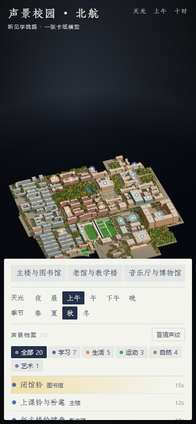

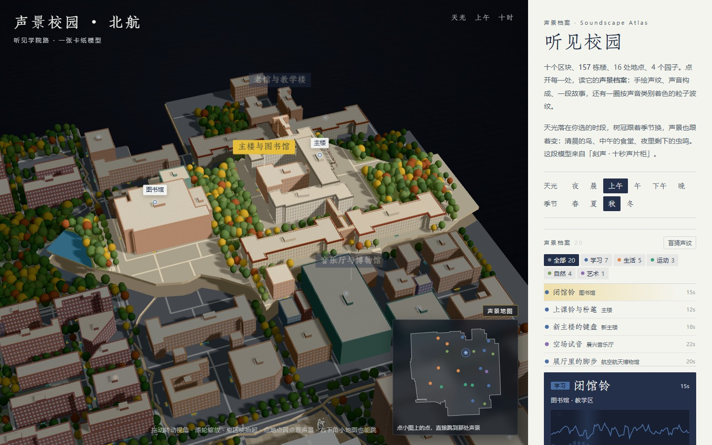

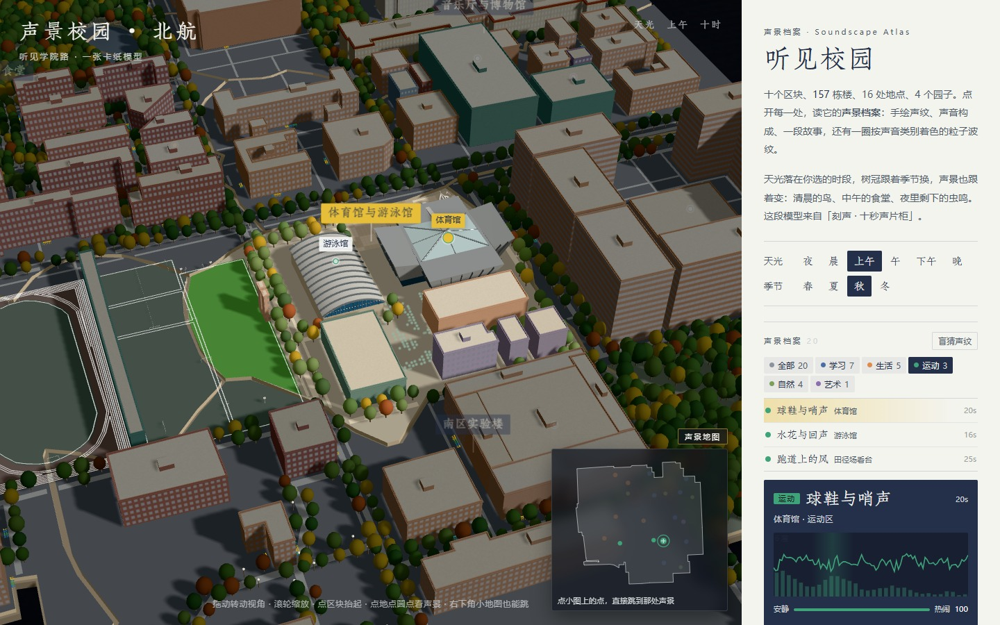

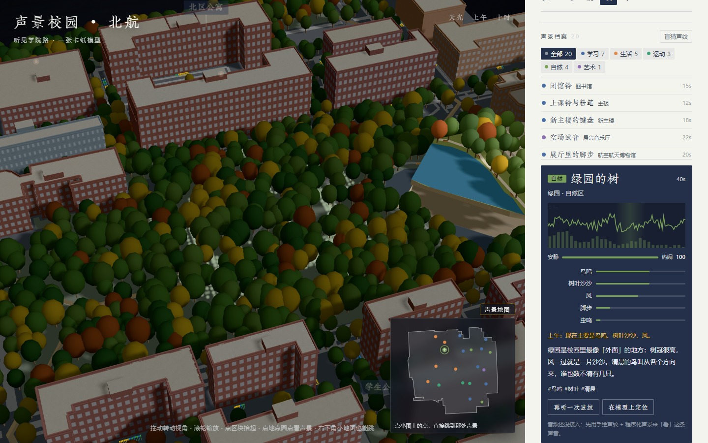

## 目录

```text
index.html              页面骨架（预渲染总览、画布、展签、控制项）
styles.css              版式；色板沿用原项目冻结的五色
serve.mjs               零依赖静态服务器
src/
  campus-scene.js       三维校园：几何、材质、影棚光、天光、四季、拾取、后期、粒子波纹
  soundscape.js         声景数据：20 条档案、五类、声音层权重、声纹生成（纯函数）
  atlas.js              声景档案 UI：列表、筛选、声纹动画、小地图、盲猜
  audio.js              程序化声景：WebAudio 合成器（噪声/滤波器/包络音），默认静音
  model.js              纯函数：纸色、立面参数、平面几何、季节色（原样搬来）
  light-rig.js          纯函数：每个时段的一套灯色（原样搬来）
  data/campus-xy.json   校园数据：十个区块、157 栋楼、16 处地点、体育馆、园子
  assets/               朱雀仿宋子集（woff2）+ 预渲染总览（poster-wide / poster-portrait）
  vendor/three/         Three.js 及用到的 addons（MIT）
tools/
  bake-poster.mjs       重新生成预渲染总览（无头 Chrome 截图）
screenshots/            这个网站自己的截图
```

## 预渲染总览是怎么来的

`src/assets/poster-wide.jpg` / `poster-portrait.jpg` 不是手画的，是用无头 Chrome 打开这个网站、在默认视角（上午 / 秋）下把画布区域截下来：

```bash
node serve.mjs                                  # 先把站点跑起来
node tools/bake-poster.mjs http://127.0.0.1:8890/
```

改了模型、默认天光或取景之后再跑一遍，总览就和三维对得上了。换了机位/天光/季节的默认值，记得同步重做这两张图。

## 与原项目的关系

原网站「刻声 · 十秒声片柜」把这座校园摆在唱盘上：校园是盘心的标签，声片钉在楼顶上，外圈刻着一个学期一个学期的声音。这个网站只留下校园本身——

**没有搬过来的**：唱盘与黑漆刻纹、唱臂、声片钉与年轮、录音/播放/馆藏/寻片、外圈学期刻纹与学期标尺、馆藏卡上的声音条目。

**搬过来的**：校区几何与材质、卡纸立面着色器、主楼线稿与校名、体育馆/游泳馆/雕塑、树/路灯/单车/长椅/球场、影棚三盏软箱、时段天光与四季、区块的抬起与压暗。

**新加的**：16 个地点圆点，以及点在楼脚地面上的波纹（二维波场 + 楼体反射 + 边界吸收），和为了让它跑得动而做的按需渲染、自动分档。

**为速度让路的**：原项目的环境光遮蔽、移轴、纸纹暗角与 PBR 材质，以及「夜→晨→上午」的开场和区块升起动画。

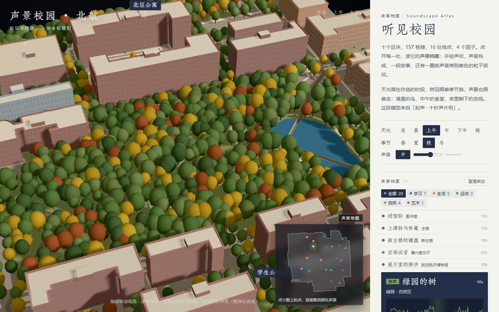

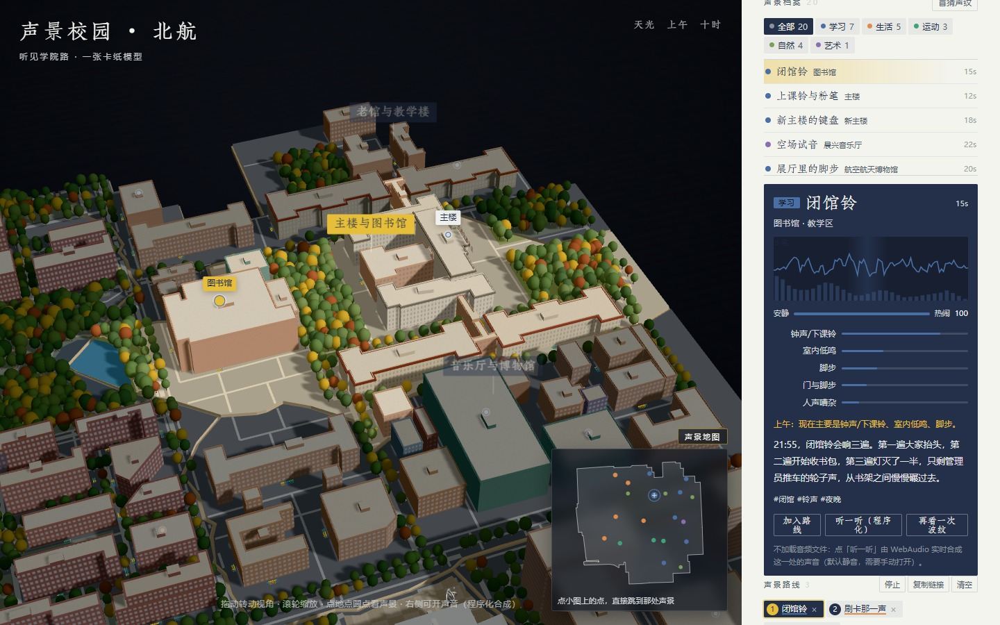

## 版本与备份

本项目按「一次创新一个备份」推进，备份都在 `D:\大学\web work` 下：

- 当前开发版：`my work` → <http://127.0.0.1:8890/>
- 历史版本：`backup_0`（粒子波纹基线）、`backup_1`（声景档案）、`backup_2`（程序化声景）、`backup_3`（声景路线）、`backup_4`（热力图）、`backup_5`（一天里的声景）、`backup_6`（明信片）、`backup_7`（路线预设）……每个备份目录里都有 `打开网站.cmd`，双击即可单独跑起来；当前版是 v4（声景路线）。
- 所有版本的索引（需要根目录服务器）：<http://127.0.0.1:8891/>

## v5–v9：继续往下长的五件小事

- **v5 声景热力图**：小地图可在「点位 / 热力」之间切换。热力模式按当前时段的热闹度给每个声景点画一团类别色的光，越吵越亮越大——一眼看出中午哪里最吵、夜里哪里还亮着。
- **v6 一天里的声景**：档案详情多了一排「夜 晨 上午 午 下午 晚」的小条，高度是该时段的热闹度，点哪一条就切到那个时段的天光与声音配比。
- **v7 声景明信片**：档案里点「保存明信片」，得到一张 1200×675 的 PNG（类别色、标题、地点、声纹、故事、标签），可以直接发给别人或贴进答辩 PPT。
- **v8 声景路线预设**：路线区多了「清晨线 / 午间线 / 夜行线 / 安静线」四条主题线和「随机漫游」，点一下直接排好四站，再按播放就能走。
- **v9 声景图鉴**：所有 20 条声景排成一本图鉴，点开过的自动收进本机（localStorage），按钮上显示「图鉴 n/20」——像一本可以慢慢填满的册子。

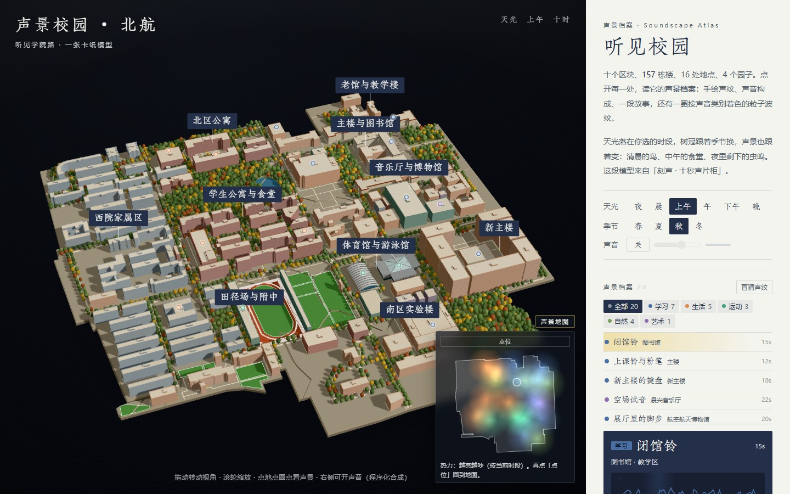

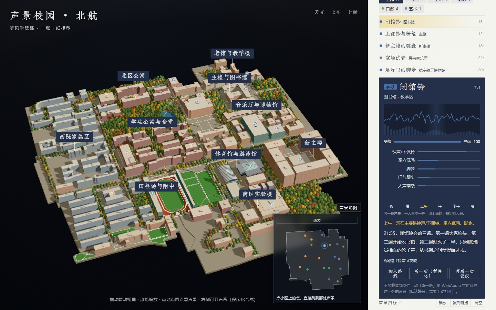

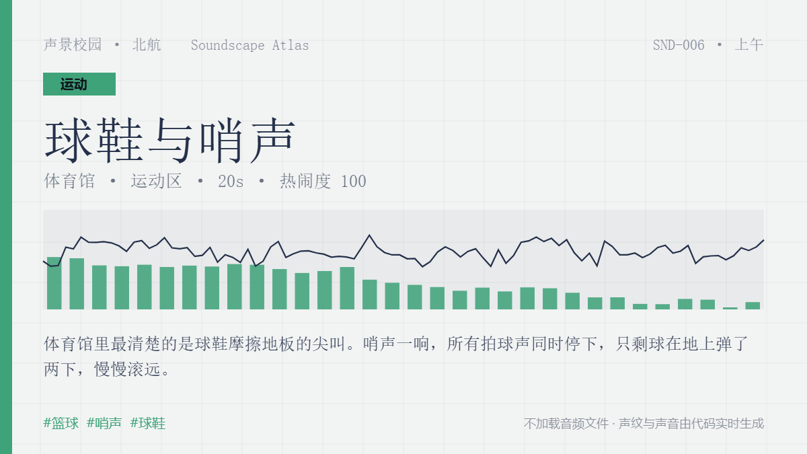

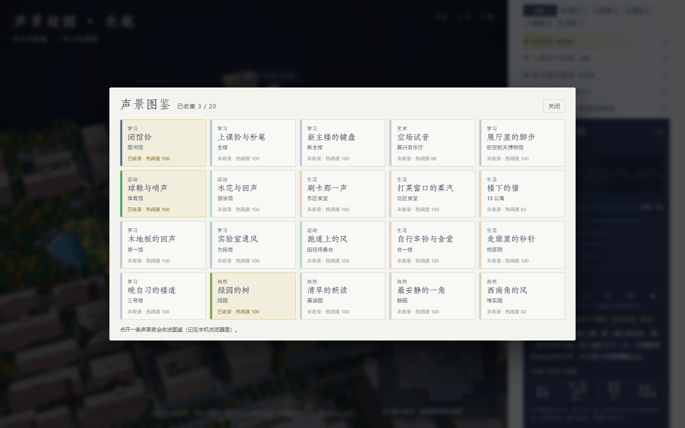

## v10–v14：再走的五步

- **v10 声景搜索**：档案区能按标题 / 地点 / 标签 / 类别搜；按 `/` 聚焦，`Esc` 清空。
- **v11 声景对比**：任挑两条声景并排看声纹、热闹度，以及「哪些声音层是共有的」。
- **v12 沉浸模式**：`Z` 或右下角按钮藏起展签与小地图，只剩校园、粒子和声音——适合演示时全屏看。
- **v13 键盘快捷键**：`1–6` 切天光、`s` 声音、`g/b/c` 图鉴/盲猜/对比、`p` 播路线、`?` 快捷键表。
- **v14 声景长图**：一键把 20 条声景按类别排成一张 1400×2000 的 PNG 长图，可直接发人。

## v15–v26：又十二步

- v15 今日声景 / v16 骰子 / v17 实时天光 / v18 我的收藏 / v19 声景笔记 / v20 复制文案 / v21 三种配色 / v22 声音统计 / v23 关于 / v24 分享视图 / v25 演示模式 / v26 声音日记。

## 木制针脚（v36 → v37）

唱片北沿旁有一支**木制针脚**，模拟"唱片在放声音"：

- **造型**：一块圆角木板（四角、边缘都做过圆滑/倒角），长 = **0.8 × 唱片半径**、宽 = **0.15 × 唱片半径**，木色 + 一道深色木纹条，针端有木针座与木针；支点是唱片上的木质转轴盘；
- **默认抬起**：没声音时抬离唱片、向外摆开（支点在唱片边缘外侧，整体离模型更远）；
- **有声音播放时落针**：默认声景播放时，针脚向唱片内摆约 28°、落在外圈纹路上；暂停（播放「我的声音」、或关掉声音）时抬回外侧，恢复播放后再落针；
- 抬/落用 0..1 平滑插值（约 0.5 秒），不参与拾取，不影响点区块/点圆点/波纹；状态见 `window.__campus.tonearm`。

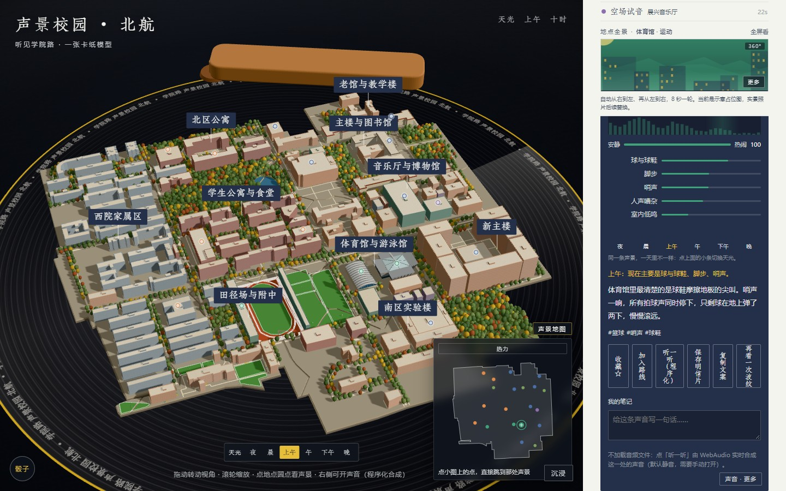

## 唱片托底（v35）

整个模型底部垫了一张大黑胶唱片（半径 ≈ 校园外接圆 + 7%），校园模型本身不动，唱片绕竖直轴**匀速旋转：60 秒一圈（6°/秒）**。

- 黑胶表面是程序生成的贴图：径向渐变底 + 一圈圈同心纹路（每 7 圈一条更亮的音轨分隔环）+ 细尘点 + 两道高光 + 外圈小字（「声景校园 · 北航 · 学院路」随唱片一起转）+ 内圈标签 + 最外一道金边；
- 唱片有 14 个场景单位的厚度（侧壁是偏金属的灰黑色，低角度看得到一块胶的厚度）；**顶面比底板底沿高 2 个单位，模型底板下半截埋进唱片里**，并在唱片顶面垫了一层以校园中心为圆心的柔和接触阴影（圆形渐变、边缘完全淡出，所以唱片上不会出现明暗分界线）——这样模型和唱片之间没有生硬的台阶，也不参与拾取，不影响点区块/点圆点/波纹；
- 为了让转动看得见，画面用 **30fps** 的轻量 tick 重画（实测约 29 fps、唱片关掉后立刻恢复「静止不重画」）；「降低动效」或系统减少动画时自动停转；
- 右侧「唱片：转 / 停」开关，或键盘 `t`；选择会记住；标签页切后台自动暂停；
- 角度用每帧 dt 累加，开关、切后台都不跳变。

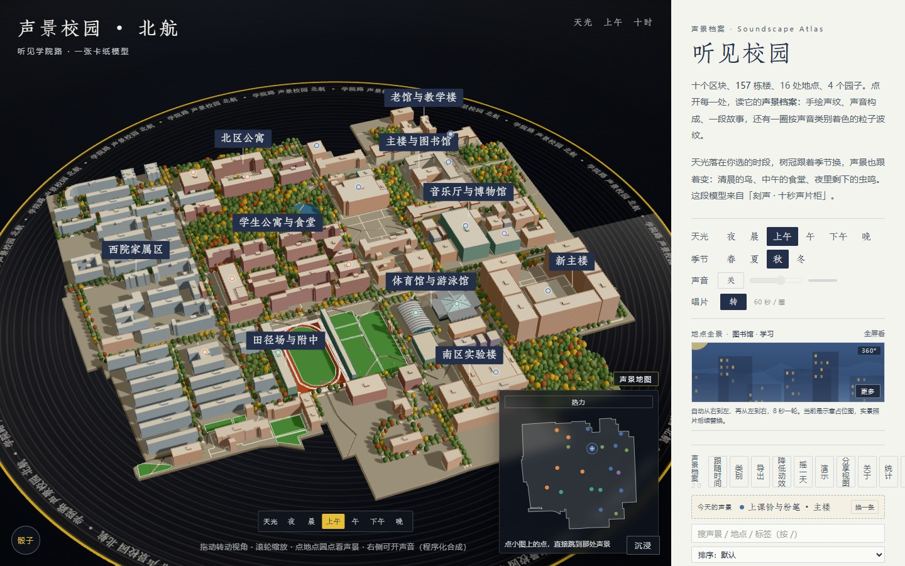

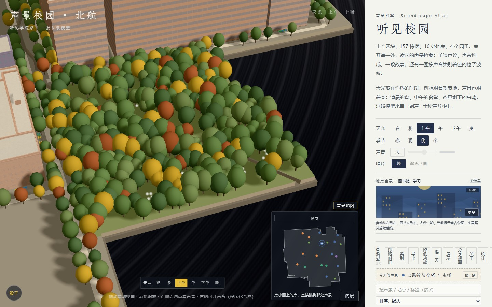

## 「更多」：我的照片 / 我的声音（v34）

- **全景小框右下角「更多」**：打开「我拍的照片」——可以上传自己拍的照片、在网格里查看、点开看大图；预置了 4 张示例照片（`src/assets/mine-photos/`）。**上方全景小框仍然恒定显示该地点的那张全景**，这里只是相册。
- **声景详情右下角「声音 · 更多」**：打开「我的声音」——可以上传自己的音频、试听、删除；预置了 3 段示例声音（`src/assets/mine-sounds/`，程序合成的鸟鸣/钟声/雨声）。**点选地点时播放的程序化声景不会变**，这里只是声音收藏。
- 上传的内容只存在你自己的浏览器里（IndexedDB），不上传服务器；单个文件上限 25MB；关闭面板或按 `Esc` 会停止试听。
- 示例素材说明：`src/assets/mine-photos/README` 无（SVG 直接可换），`src/assets/mine-sounds/README.md` 有清单。
- **默认声景会临时让路**：播放「我的声音」里任意一段时，当前地点的程序化声景自动暂停；这段播完（或关闭面板 / 再点停止）后自动恢复原来那条，不用重新点地点。

## 地点全景（v33）

右侧导引栏新增「地点全景」小框：选中哪处地点，就显示那一处的横幅全景；画面自动从右端扫到左端、再扫回右端，8 秒一轮。小框固定在右栏顶部（右栏滚动时也可见），不覆盖三维画面。

- 占位图是程序生成的 SVG（20 条声景各一张），放在 `src/assets/panorama/`；
- 真实照片：把同名 `snd-001.jpg`（建议 3200×1000 左右的横幅）放进该目录即可，页面优先加载 jpg，缺失时回退到 SVG；
- 文件与地点的对应关系写在 `src/assets/panorama/README.md`；
- 小框右上角「全屏看」可打开原图。

## v27–v31：最后五步

- v27 摇一天（随机天光/季节/三站路线）/ v28 降低动效 / v29 列表排序 / v30 导出收藏与笔记 / v31 五类声音说明卡。

## 许可与出处

- **代码**：MIT，见 [LICENSE](LICENSE)。出处是「刻声 · 十秒声片柜」© 2026 naruto7（MIT）。
- **预渲染总览图**：由本项目的三维场景渲染而来，随代码同许可。
- **校园地图数据**（`src/data/campus-xy.json` 派生自公开地图）：© OpenStreetMap contributors，**ODbL 1.0**。转载或再分发这份数据时请保留署名，并以同一许可开放衍生数据。
- **校园体量**：参考 MrRoam/buaa-xueyuan-campus-3d（作者估算，非测绘）。
- **三维**：Three.js（MIT）。**字体**：朱雀仿宋（SIL OFL 1.1，子集化）。
- 楼与分区是示意，不按测绘比例，**不用于导航**。
- **声景档案与程序化声景**（20 条故事的文案、类别、声音层权重、声纹与音频合成算法）是为本项目原创的示意内容，**不含任何真实录音或第三方音频素材**；所有声音由 WebAudio 在浏览器里实时合成。

完整出处与许可边界见 [NOTICE.md](NOTICE.md)。


