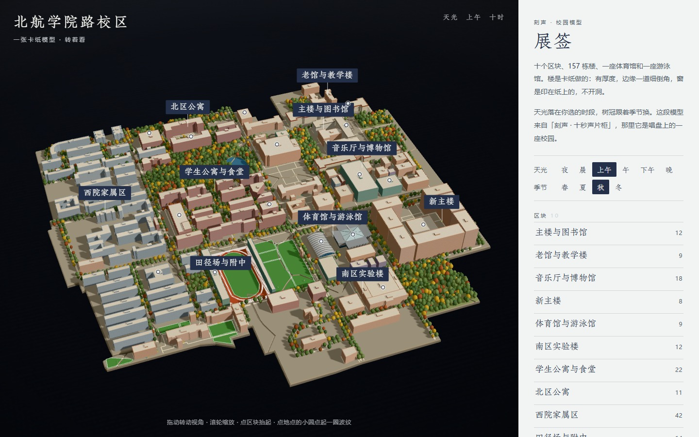
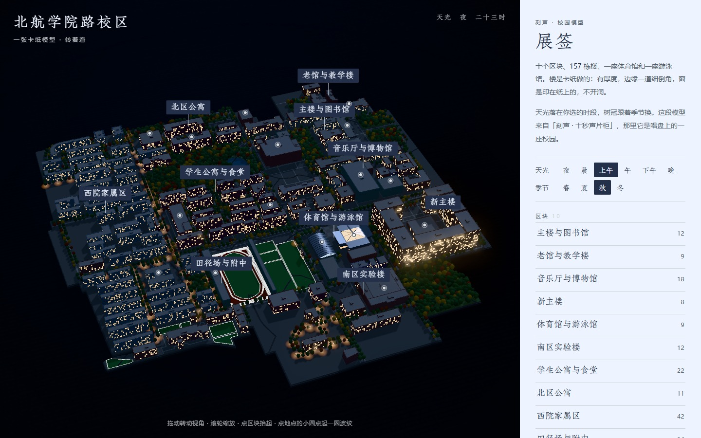
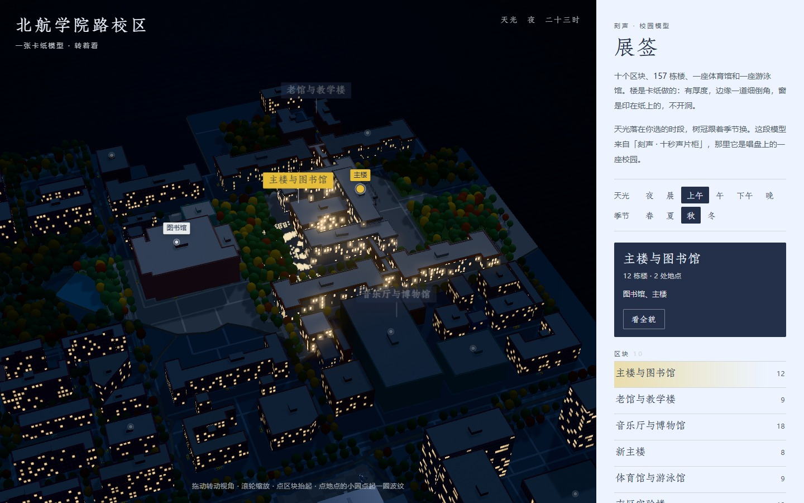
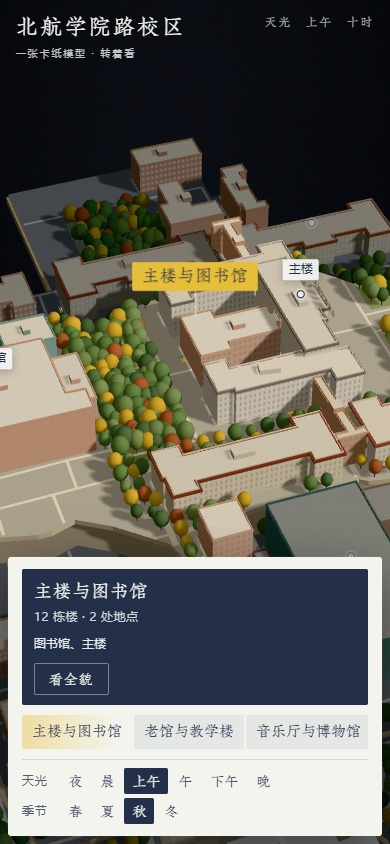
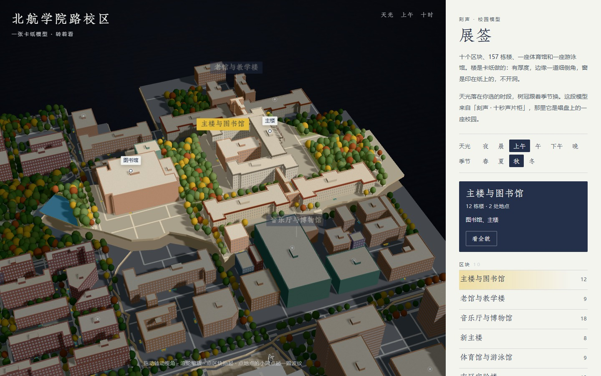
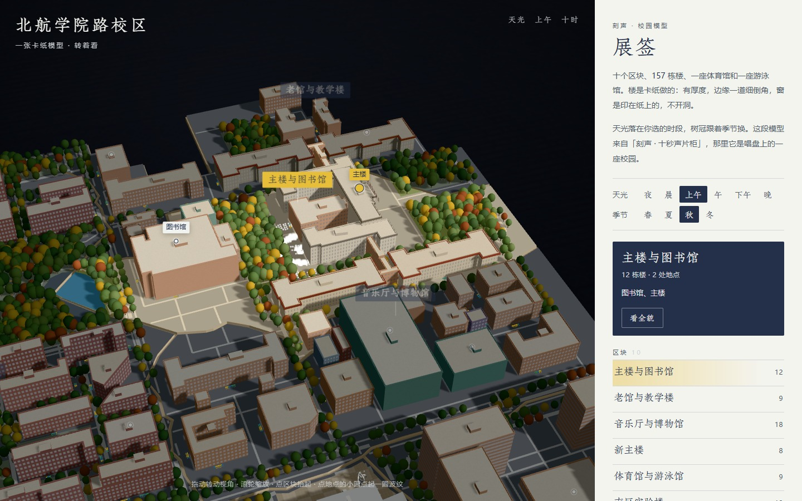
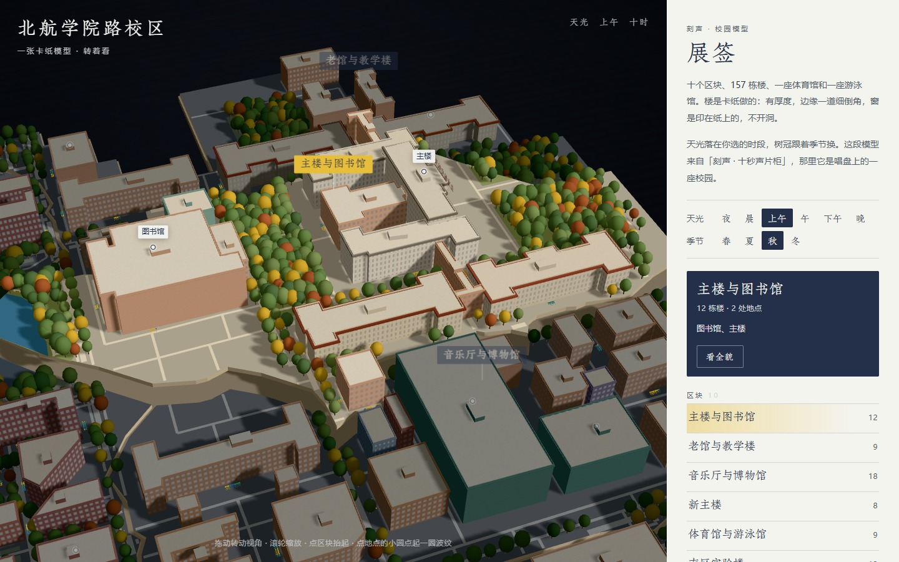

# 北航学院路校区 · 一张卡纸模型

从「刻声 · 十秒声片柜」的三维校园里，把**校区模型**整段抽出来，做成一个只关于校园的独立网站：一座可以用鼠标绕着看、按天光换色、按季节换树的卡纸校园。

**打开就是完整的校园。** 页面里内置了一张预渲染的总览图，网络一到就能看到整座校园；大约 1 秒内，它会被可转动的三维模型替换掉（同一机位，看不出接缝）。

模型上钉着 16 个小圆点，对应校园里的 16 处地点。点一下，相机飞到它所在的区块，同时从楼脚的地面上荡开一圈水波式的同心环——波纹会绕着楼走、撞上墙会反射、越扩越淡，两三秒后消失。换个地点再点，旧的波纹会很快淡掉，新的接着荡开。







## 跑起来

```bash
node serve.mjs          # http://127.0.0.1:8890
```

没有依赖、没有构建步骤。页面用原生 ES 模块和 `fetch` 读 JSON，所以**必须经 HTTP 打开**——直接双击 `index.html`（`file://`）会被浏览器的 CORS 拦掉。`serve.mjs` 就是一个零依赖的静态服务器，也可以用别的服务器指着这个目录。

## 打开有多快、转起来有多顺

在本机（Intel UHD 核显、Chrome）量到的：

| 情况 | 结果 |
|---|---|
| 预渲染总览上屏 | 约 0.2–0.3 秒（纯 HTML + 一张 200 KB 的图，不等 JS） |
| 模型数据 + 搭建（157 栋楼全部几何） | 约 0.33 秒 |
| 三维第一帧（顶上总览、可以开始转） | 约 0.9 秒（硬件渲染） |
| 硬件渲染拖动帧率 | ~59 fps（帧时中位 17 ms） |
| 软件渲染（没开硬件加速） | 自动进 low 档：第一帧约 0.45 秒，拖动约 45 fps |
| 点一个地点、波纹连续荡开 2 秒 | ~60 fps（满档；只多算一块 363×349 的波场，low 档是 170×164） |
| 静止时 | **不重画**：只剩一个极轻的 rAF 空转，`window.__timing.rendered` 不再增长 |

两件关键的事：

1. **画面只在有变化时重画**。转动、缩放、点区块、点地点起波纹、换天光、换季、改窗口大小才渲染；静止时一帧都不画。以前是每帧都重画，慢机器上等于把 CPU 一直占满，看起来就像「卡死」。
2. **按机器自动分档**。软件渲染（没开硬件加速）一进来就是 low 档：0.85 倍像素、不开抗锯齿与阴影、二分之一的树、不放单车长椅；这是从 6 fps 拉到 45 fps 的主要来源。硬件渲染从 full 档开始，如果实测帧时超过约 30 fps 的门槛，会在拖动时自动逐级降像素比、稀疏树木、藏掉小道具（只改像素比和实例数量，不重编译材质，所以不会中途卡一下）。

也就是说：**不管机器多慢，三秒之内一定已经看到整座校园**；快一点的机器上，1 秒内就能转。

## 它是什么

模型里的每一样东西都来自原项目的三维校园，逐段搬过来，去掉的只有「声音」那一层。

- **十个区块、157 栋楼**：主楼与图书馆 / 老馆与教学楼 / 音乐厅与博物馆 / 新主楼 / 体育馆与游泳馆 / 南区实验楼 / 学生公寓与食堂 / 北区公寓 / 西院家属区 / 田径场与附中。
- **卡纸做法**：墙身有一道 0.35 米的细倒角，檐口、女儿墙、屋顶小房都是纸边；窗**不开洞**，是印在纸上的立面（顶点着色器按层数/开间排窗），入夜按比例亮起暖光。
- **特写**：主楼朝学院路的东立面是一张照照片描的线稿（含四柱门廊），屋顶立着「北京航空航天大学」；园子里插着绿园、晨读园、静园、唯实园的小纸牌。
- **两个地标**：体育馆（十字平面、外斜铝壳、东西翘翼、心形凹口、尖翼、北面大台阶与花池、馆前雕塑）与游泳馆（筒拱顶、十三道外露钢屋架、两端玻璃山墙）。
- **人的尺度**：树（四季换冠）、路灯（入夜发光、地面一圈暖光）、共享单车、长椅、球门、篮架、跑道画线、球场边线。
- **天光**：夜 / 晨 / 上午 / 午 / 下午 / 晚，六个时段各自一套太阳方位、高度角、色温、亮窗比例；换时段时光是平滑过渡的。
- **四季**：春 / 夏 / 秋 / 冬，树冠配色、落叶比例、地面三色、屋面积雪都跟着换。
- **光与影**：一盏太阳 + 两盏半球光，影子只在天光变化、区块抬起、换季时重画（绕视角时不再算一遍）。
- **后期**：白天不出后期链，直接渲染；只有入夜且画质够时才按需建一条泛光链（窗灯、路灯那层光晕）。
- **地面波纹**：点模型上代表 16 处地点的小圆点，会从它所在区块的中心荡开一圈圈**白色粒子环**。波纹是一块铺满校园的二维波场实时算出来的（不是贴图动画），粒子只出现在波峰经过的位置：楼是硬墙，波撞上去会反射、绕过去；校园边界内侧是一圈吸收带，波到边上不会弹回来。**波速约 45 米/秒、一圈波 2 秒走完约 90 米**；波峰处显示成一颗颗白色小亮点（连起来就是一圈圈套着的粒子环），其它位置不画，粒子面比地面高约 1.4 米。波一边扩散一边变淡，寿命末尾平滑收掉，夜里偏暖色。换地点时，旧波**只加快振幅衰减**（约 0.3–0.6 秒淡掉），波速和波长保持不变。整个波场在开机时预先建好（约 7 ms），第一次点地点不会卡一下；low 档用更粗的网格、只留一层波。

「略微粗略」是这一版的取舍：原项目里的环境光遮蔽、移轴、纸纹暗角、PBR 金属反光都没有搬过来；low 档为了帧率还会再省掉阴影和一半的树——换来的是从 6 fps 到 45 fps。

## 交互

- 拖动画布：转视角；滚轮 / 双指：缩放；松开不动即视为点击。
- 点一个区块：它抬起来、其他区块压暗，右侧展签显示这一块的楼数与地点。
- 模型上的 16 个小圆点 = 16 处地点：悬停出地名，点一下 → 相机飞到它所在的区块、其他压暗，同时从该区块中心荡开一圈地面波纹（这时区块不抬起，好让波纹贴在地面上看得清）。
- 右侧展签：天光、季节、区块名单；悬停名单里的区块也会让模型上对应的区块抬起来。
- 键盘：方向键转视角、`+` / `-` 缩放、`Esc` / `0` 看全貌。
- 地址栏参数：`?slot=夜`、`?season=冬`、`?zone=XY-04`、`?q=full`（强制全画质）、`?q=lite`（省电：1 倍像素、无抗锯齿/阴影）、`?q=low`（最低：0.85 倍像素、稀疏的树、无小道具）、`?dpr=0.7`（手动钉像素比）。
- 窄屏：展签收成底部的一条横条，区块名横向滚动。
- 想看耗时/画质：控制台里 `window.__timing`（各阶段毫秒、已渲染帧数）和 `window.__campus.quality`（当前档位、像素比、实测帧时中位）。









## 目录

```text
index.html              页面骨架（预渲染总览、画布、展签、控制项）
styles.css              版式；色板沿用原项目冻结的五色
serve.mjs               零依赖静态服务器
src/
  campus-scene.js       三维校园：几何、材质、影棚光、天光、四季、拾取、后期、地面波纹
  model.js              纯函数：纸色、立面参数、平面几何、季节色（原样搬来）
  light-rig.js          纯函数：每个时段的一套灯色（原样搬来）
  data/campus-xy.json   校园数据：十个区块、157 栋楼、16 处地点、体育馆、园子
  assets/               朱雀仿宋子集（woff2）+ 预渲染总览（poster-wide / poster-portrait）
  vendor/three/         Three.js 及用到的 addons（MIT）
tools/
  bake-poster.mjs       重新生成预渲染总览（无头 Chrome 截图）
screenshots/            这个网站自己的截图
```

## 预渲染总览是怎么来的

`src/assets/poster-wide.jpg` / `poster-portrait.jpg` 不是手画的，是用无头 Chrome 打开这个网站、在默认视角（上午 / 秋）下把画布区域截下来：

```bash
node serve.mjs                                  # 先把站点跑起来
node tools/bake-poster.mjs http://127.0.0.1:8890/
```

改了模型、默认天光或取景之后再跑一遍，总览就和三维对得上了。换了机位/天光/季节的默认值，记得同步重做这两张图。

## 与原项目的关系

原网站「刻声 · 十秒声片柜」把这座校园摆在唱盘上：校园是盘心的标签，声片钉在楼顶上，外圈刻着一个学期一个学期的声音。这个网站只留下校园本身——

**没有搬过来的**：唱盘与黑漆刻纹、唱臂、声片钉与年轮、录音/播放/馆藏/寻片、外圈学期刻纹与学期标尺、馆藏卡上的声音条目。

**搬过来的**：校区几何与材质、卡纸立面着色器、主楼线稿与校名、体育馆/游泳馆/雕塑、树/路灯/单车/长椅/球场、影棚三盏软箱、时段天光与四季、区块的抬起与压暗。

**新加的**：16 个地点圆点，以及点在楼脚地面上的波纹（二维波场 + 楼体反射 + 边界吸收），和为了让它跑得动而做的按需渲染、自动分档。

**为速度让路的**：原项目的环境光遮蔽、移轴、纸纹暗角与 PBR 材质，以及「夜→晨→上午」的开场和区块升起动画。

## 许可与出处

- **代码**：MIT，见 [LICENSE](LICENSE)。出处是「刻声 · 十秒声片柜」© 2026 naruto7（MIT）。
- **预渲染总览图**：由本项目的三维场景渲染而来，随代码同许可。
- **校园地图数据**（`src/data/campus-xy.json` 派生自公开地图）：© OpenStreetMap contributors，**ODbL 1.0**。转载或再分发这份数据时请保留署名，并以同一许可开放衍生数据。
- **校园体量**：参考 MrRoam/buaa-xueyuan-campus-3d（作者估算，非测绘）。
- **三维**：Three.js（MIT）。**字体**：朱雀仿宋（SIL OFL 1.1，子集化）。
- 楼与分区是示意，不按测绘比例，**不用于导航**。

完整出处与许可边界见 [NOTICE.md](NOTICE.md)。


