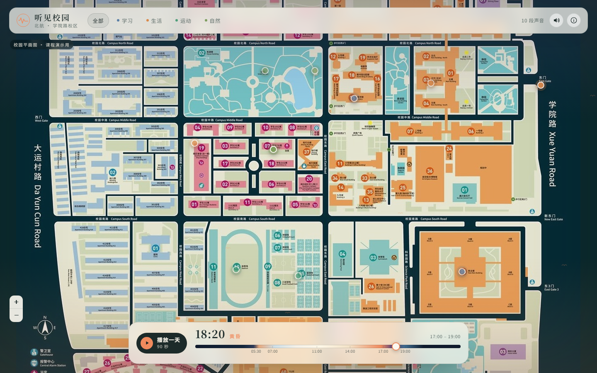
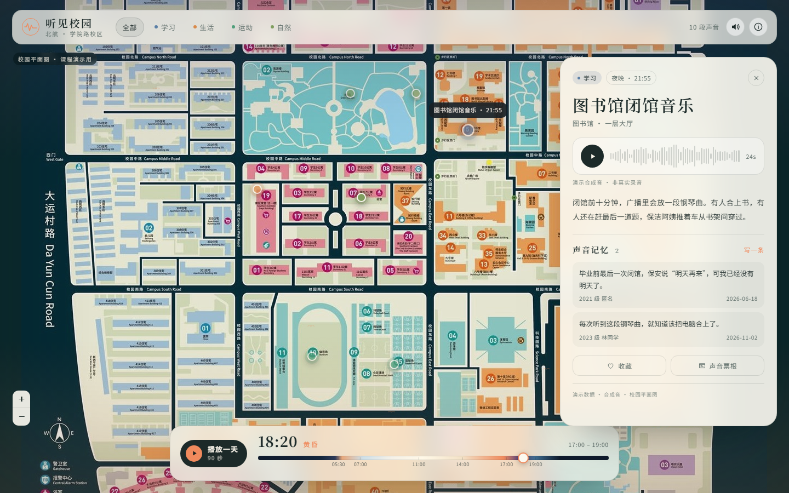

# 听见校园 · 声景地图（MVP）

北京航空航天大学学院路校区的声景地图课程演示版。拖动底部时间轴，看校园从清晨到深夜；点开任意声音点，听一段校园切片，读一条别人留下的声音记忆。

> **演示版说明**：不含真实录音，播放的是 Web Audio 实时合成音；底图取自北航学院路校区平面图，仅用于课程演示；收藏与投稿只保存在本机。

## 界面预览






## 运行

### 方式一：一键启动（推荐）

双击项目根目录的 `start.cmd`。它会自动安装依赖、启动开发服务器并打开浏览器。

### 方式二：命令行

```bash
npm install
npm run dev      # http://127.0.0.1:5173
```

> 需要 Node.js 20.19+ 或 22.12+。若 PowerShell 提示 `npm.ps1` 无法运行，改用 `npm.cmd install` / `npm.cmd run dev`。

### 方式三：双击打开的独立版

```bash
npm run build:standalone
```

构建完成后双击 `dist-standalone/index.html`，不需要服务器，也不会白屏。

> 根目录的 `index.html` 是 Vite 的入口模板，**不能直接双击打开**：它通过 ES Module 加载 `/src/main.ts`，浏览器在 `file://` 下会拦截模块请求，所以显示空白。请用上面的方式一/二/三。

生产构建：

```bash
npm run build
npm run preview  # http://127.0.0.1:4173
```

## 已实现

- 全屏校园平面图（Leaflet `CRS.Simple` + 官方平面图叠加），10 个声音点
- 学习 / 生活 / 运动 / 自然四类筛选
- 24 小时时间轴：黎明、上午、正午、下午、黄昏、夜晚六段主题
- 地图色调、天空渐变、粒子随时间段切换
- 「播放一天」：90 秒走完 24 小时，按时间触发声音
- 声音详情：合成音播放、波形进度、地点、故事、记忆、收藏
- 声音记忆投稿（本机保存，标记「待审核」）
- 声音票根与链接复制
- 响应式：桌面右侧抽屉，移动端底部 sheet
- 「关于」页包含数据、合成音、地图来源的完整声明

## 结构

```text
src/
├─ assets/campus-plan.jpg  # 学院路校区平面图（裁剪）
├─ audio/engine.ts         # Web Audio 合成器（环境底噪 + 声音动机）
├─ components/             # 地图、顶栏、时间轴、详情、播放一天、弹窗
├─ data/sounds.ts          # 10 条演示声音与像素坐标
├─ stores/                 # sound / time / ui
├─ themes/index.ts         # 六个时段主题与时间映射
├─ styles/base.css         # 设计变量、Leaflet 覆盖、弹窗
└─ views/MapView.vue
```

## 数据

所有声音都在 `src/data/sounds.ts`：

- `id` / `title` / `category` / `slot` / `timeLabel`
- `place` / `x` / `y`：`x`、`y` 是平面图上的像素坐标（图宽 1361、高 1320）
- `story` / `duration`
- `motif`：合成音参数（真实录音接入后可替换为 `audio.src`）
- `memories`：预置的声音记忆

## 地图

底图是 `src/assets/campus-plan.jpg`，从北航学院路校区平面图裁剪出主图区域（1361 × 1320），用 Leaflet `CRS.Simple` 直接按像素坐标打点：

- 图书馆 (815, 397)、主楼 (1000, 360)、新主楼 (1075, 815)
- 绿园 (600, 330)、荷花池 (720, 330)、田径场 (530, 810)、篮球场 (680, 825)
- 东门 (1265, 365)、一食堂 (430, 505)、学生公寓 (620, 520)

底图版权归原图作者与学校所有，仅用于课程演示，不作商业用途。

## 许可

代码仅用于课程作业。Leaflet（BSD-2-Clause）、Vue（MIT）各自遵循原许可。
